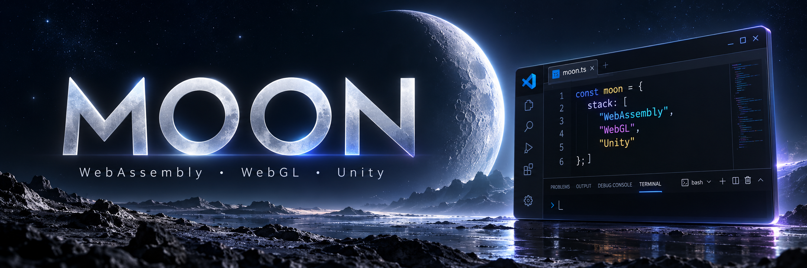

  

  <strong>Moi, c’est Moon.</strong> 
  Je porte des jeux dans le navigateur et j’expérimente avec les technologies du Web. 
  Du moteur de jeu à une page Web : rendu, sons, contrôles et multijoueur.

  <code>WebAssembly</code> · <code>WebGL</code> · <code>Unity / C#</code> · <code>JavaScript</code> · <code>WebRTC</code>

---

### 🎮 Mes projets

| Projet | Dans l’atelier |
| :--- | :--- |
| **[Fart Together · WebGL](https://github.com/a01083831422-gif/Fart-game-demo-wasm)** | Portage Unity vers le navigateur, adaptation des shaders, restauration de l’audio et salons entre amis avec WebRTC. |
| **[Minecraft 26.3 · Web](https://github.com/a01083831422-gif/minecraft-26.3-web)** | Expérimentations autour de Minecraft, de WebAssembly et du chargement de modules dans le navigateur. |
| **[Minecraft Classic · WASM](https://github.com/a01083831422-gif/Minecraft-Classic-WASM)** | Exploration de Minecraft Classic, de son code Java et d’une adaptation pour le Web. |

### 🛠️ Ce que j’explore

- Faire fonctionner des jeux dans une page Web.
- Adapter les graphismes, les interfaces et les contrôles au navigateur.
- Charger et héberger les fichiers WebAssembly avec GitHub Pages.
- Connecter des joueurs avec WebRTC et des salons entre amis.

  Des essais, des corrections, puis une nouvelle version à tester.

